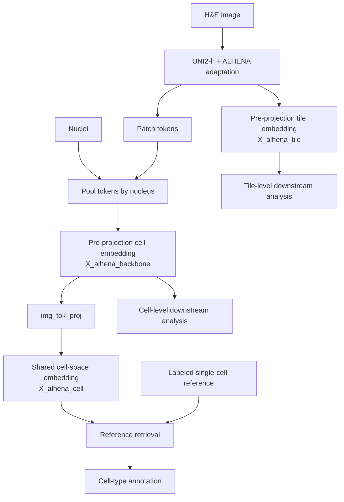
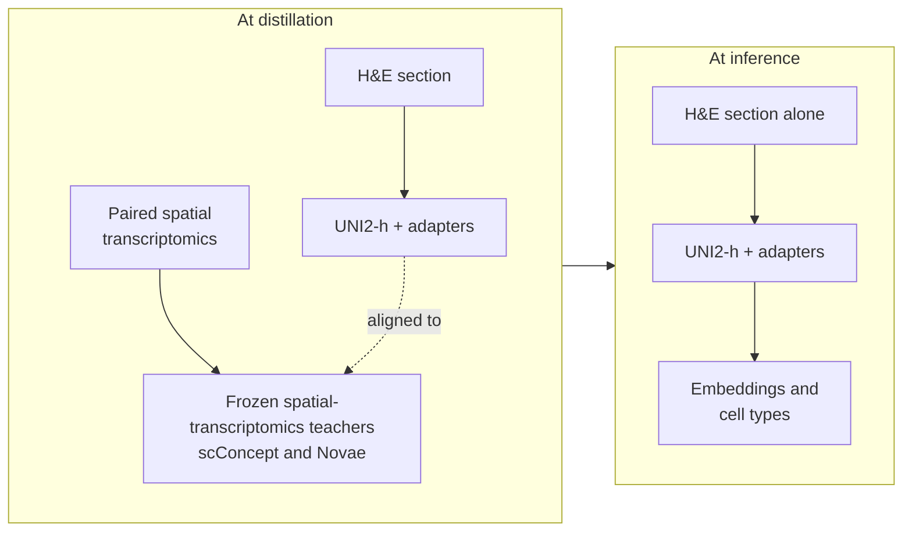

# How ALHENA works

ALHENA adapts the UNI2-h pathology encoder with low-rank adapters and projection heads trained by
contrastive distillation from spatial transcriptomics models. scConcept provides cell-level
molecular supervision, while Novae provides neighborhood-level supervision.

At inference, ALHENA requires only H&E images. The molecular information is used during training
to shape the image-derived representations; no spatial transcriptomics or gene-expression
measurements are required to encode a new slide.

## Representations at tile and cell scales

The adapted UNI2-h encoder reads the H&E once. Everything ALHENA returns branches from that pass.



- **The tile embedding (`X_alhena_tile`)** is the pre-projection representation used for
  tile-level downstream analysis.
- **The cell embedding (`X_alhena_backbone`)** is obtained by pooling image tokens over each
  nucleus and is the pre-projection representation used for cell-level downstream analysis.
- **The shared cell-space embedding (`X_alhena_cell`)** is obtained by projecting the cell
  embedding through `img_tok_proj`. This is the representation used for comparison with the
  single-cell reference during annotation.

Cell-type annotation therefore adds a reference-based interpretation to the cell representation;
it does not replace the underlying image-derived embedding.

## From H&E to ALHENA outputs

The main processing steps are:

1. **Prepare the H&E image.** Tiles are resampled to the resolution used by ALHENA and fitted to
   the model input canvas.
2. **Encode each tile.** The adapted UNI2-h encoder produces a tile-level representation together
   with patch-token representations.
3. **Pool tokens over nuclei.** When nuclei are provided, ALHENA combines the tokens overlapping
   each nucleus to obtain one pre-projection cell embedding.
4. **Project cells into the shared cell space.** `img_tok_proj` maps each cell embedding into
   `X_alhena_cell`.
5. **Retrieve reference cells, when annotation is requested.** Image-derived cells are compared
   with cells from a labeled single-cell reference in the shared cell space.
6. **Assign a cell type.** Retrieved reference cells contribute a weighted vote over the classes
   represented by the reference.

`encode_tiles()` returns the tile-level representation. `encode_cells()` returns both cell
representations. `annotate()` additionally performs reference retrieval and returns the cell-type
annotations.

The pre-projection tile and cell embeddings can be analyzed independently of cell annotation. See
[Downstream analysis](../outputs/downstream-analysis.md).

## What distillation changes

Spatial transcriptomics is expensive and rare. H&E is cheap and collected everywhere. ALHENA is
trained where both exist, and run where only the H&E does.



Contrastive distillation aligns H&E-derived representations with molecular representations
provided by the frozen spatial transcriptomics teachers. The resulting ALHENA embeddings are still
computed entirely from H&E at inference.

The pre-projection tile and cell embeddings are the image representations exposed for general
downstream analysis. Projection heads map these representations into shared spaces used during
contrastive alignment. For cell annotation, `img_tok_proj` maps the pre-projection cell embedding
into the shared cell space used for reference retrieval.

ALHENA embeddings should therefore be interpreted as **molecularly informed image
representations**, not as gene-expression measurements or predictions of individual genes.

## The shared cell space

Cell annotation takes place in a 512-dimensional representation shared by the image and
single-cell sides of ALHENA.

```text
image side:
X_alhena_backbone
        ↓ img_tok_proj
   shared cell space

single-cell side:
scConcept representation
        ↓ st_node_proj
   shared cell space
```

`img_tok_proj` maps the pre-projection image-derived cell embedding into `X_alhena_cell`. When a
reference is built, `st_node_proj` maps the corresponding single-cell representations into the
same space.

This shared representation allows an H&E-derived cell to be compared directly with labeled cells
from a single-cell atlas.

`X_alhena_cell` is derived from `X_alhena_backbone` and is specifically optimized for this
cross-modal comparison. For general unsupervised analysis of image-derived cellular variation, use
the pre-projection representation instead.

See [Where a reference comes from](references.md#where-a-reference-comes-from).

!!! note "The tile-level projection head"
    ALHENA also contains an image-side projection trained against the Novae neighborhood
    representation. `encoder.project_tile()` exposes this projection, but it is not stored in the
    standard `TileEmbeddings` result and is not used for reference retrieval. Standard tile-level
    downstream analysis uses `X_alhena_tile`.

## Important consequences for interpreting the outputs

The path from input to output is explicit. The
[annotation workflow](cell-typing.md#annotation-workflow) lists each step in the order the code
runs it. Four of those steps shape how the outputs should be interpreted.

### Geometry comes first

ALHENA operates at a fixed physical image scale. Input tiles are resampled to 0.425 µm/px and
mapped onto a 224 × 224 pixel model canvas, corresponding to a 95.2 µm field of view. The
patch-token grid is 16 × 16, so each token covers approximately 5.95 µm.

The physical resolution supplied with the image therefore affects both tile-level and cell-level
representations. An incorrect but plausible resolution may not raise an error, so image scale
should be verified before encoding. See [Geometry](geometry.md).

### A cell embedding is pooled, not cropped

ALHENA does not crop an individual image around each nucleus. Instead, it identifies the image
tokens overlapping the nucleus and combines them according to the number of nuclear pixels
contained in each token.

Because these tokens were computed in the context of the surrounding tile, the resulting cell
embedding contains both nucleus-associated information and local tissue context. See
[Cell pooling](cell-pooling.md).

A cell found in several overlapping tiles resolves to one row. That is why cell identifiers must
be unique across all the tiles read together, not only within a tile.

### The cell path reuses one forward pass

Tile representations and patch tokens are produced during the same image-encoder forward pass.
`encode_cells()` therefore encodes each required tile once and pools the corresponding tokens to
obtain cell embeddings.

The tile embeddings generated during this workflow are retained in `cells.tiles` with
`purpose="cell_context"`. By default, they cover only the tiles required by the supplied nuclei
and should not automatically be interpreted as a systematic tile-level sampling of the slide. See
[Dedicated tiles and cell-context tiles](../outputs/tile-embeddings.md#dedicated-tiles-and-cell-context-tiles).

Cell encoding does not depend on the single-cell reference. `CellEmbeddings` can therefore be
saved and annotated later with another compatible reference or annotation axis without rerunning
the image encoder. See [Annotating cells again](cell-typing.md#annotating-cells-again).

### Cell types come from reference retrieval

ALHENA does not use a fixed H&E cell-type classifier. The projected image-derived cell is compared
with labeled cells from a single-cell reference, and the retrieved neighbors contribute a weighted
vote over the classes represented by that reference.

This has two important consequences:

- **The available cell types depend on the reference and annotation axis.** A class absent from
  the reference cannot be predicted.
- **No model is fitted to the deployment dataset.** Changing the reference changes the available
  taxonomy without retraining the H&E encoder.

## Interpreting a cell-type annotation

Each annotation includes a `confidence` value representing the fraction of the weighted
reference-neighbor vote assigned to the winning class.

Confidence measures **agreement among the retrieved reference neighbors**. It is not a calibrated
probability that the predicted cell type is correct.

The raw image-to-reference cosine similarities should not be used as universal confidence
thresholds. If annotation filtering is required, calibrate a confidence threshold on labeled data
relevant to the application.

See [Cell typing](cell-typing.md) for the retrieval operator, confidence, abstention, and
evaluation.

---

**Next:** [Geometry](geometry.md)
