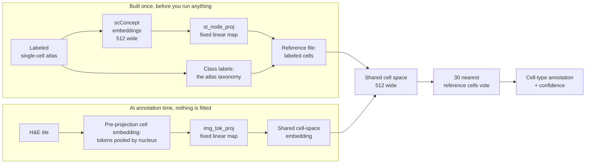

# References

A reference contains labeled single-cell representations projected into ALHENA's shared cell
space. During annotation, image-derived cells are compared with these reference cells and receive
one of the classes represented by the selected annotation axis.

This page explains how references are constructed, what the prebuilt references contain, how
reference composition affects annotation, and how to build a custom reference.

For the practical workflow, see [Inputs → References](../inputs/references.md). For the retrieval
procedure and confidence values, see [Cell typing](cell-typing.md).

If you are using a prebuilt reference, the sections through
[Reference compatibility](#reference-compatibility) cover the information needed to choose,
inspect, and interpret it. If you are creating your own reference, you can then continue directly
to [Building a custom reference](#building-a-custom-reference).

## What a reference file contains

ALHENA reference files use the `.safetensors` format. A prebuilt reference contains the projected
single-cell embeddings together with the class code assigned to each atlas cell on the supported
annotation axes.

| Tensor | Shape | Type | What it is |
|---|---|---|---|
| `embeddings` | `(n_cells, 512)` | float16 | one projection per atlas cell, in the row order of the source atlas |
| `lineage_v1` | `(n_cells,)` | int8 | the class code of each cell on that axis, `-1` for a cell with none |
| `compartment_v1` | `(n_cells,)` | int8 | the class code of each cell on that axis, `-1` for a cell with none |

The reference does not contain the original gene-expression matrix, gene identifiers, cell
barcodes, or complete source-atlas annotations.

Its metadata records information needed for compatibility and interpretation, including the
reference name, cell count, `cell_space_id`, and class support.

A reference is loaded on one [annotation axis](cell-typing.md#the-two-class-axes) at a time. Atlas
cells without a class on that axis are excluded from the retrieval pool.

## Where a reference comes from

Reference construction starts from a labeled single-cell atlas. The atlas is embedded with the
single-cell model, then `st_node_proj` maps those representations into the same shared cell space
used by projected H&E-derived cells.

Class labels remain attached to the corresponding atlas cells. Annotation does not fit or fine-tune
this reference; it only retrieves nearby reference cells and aggregates their labels.



Both sides must be projected into the same learned cell space, which is why encoder outputs and
references are checked through `cell_space_id`.

The available annotation classes are determined by the reference and annotation axis. If no
reference cell represents a class, that class cannot be predicted.

## Prebuilt references

ALHENA provides fourteen prebuilt reference files covering fifteen human tissue names;
`LymphNode` and `Tonsil` use the same reference.

References are downloaded independently, so selecting one tissue does not load the other tissue
references.

All prebuilt references are derived from human single-cell atlases. See
[Can I use ALHENA on tissue from another species?](../faq.md#can-i-use-alhena-on-tissue-from-another-species)
for the implications of using these references outside human tissue.

| Reference | Tissue names | Cells | Size | Source |
|---|---|---:|---:|---|
| `bone_marrow` | BoneMarrow | 421,775 | 433 MB | DISCO |
| `breast` | Breast | 174,638 | 179 MB | DISCO |
| `cervix` | Cervix | 77,518 | 80 MB | Gene Expression Omnibus, accession GSE208653 |
| `heart` | Heart | 624,358 | 641 MB | DISCO |
| `intestine` | Colon | 414,406 | 425 MB | DISCO |
| `kidney` | Kidney | 103,547 | 106 MB | DISCO |
| `liver_cell` | Liver | 367,596 | 377 MB | DISCO |
| `lung` | Lung | 221,012 | 227 MB | DISCO |
| `ovary` | Ovary | 124,128 | 127 MB | DISCO |
| `pancreas_cell` | Pancreas | 188,369 | 193 MB | DISCO |
| `prostate` | Prostate | 21,030 | 22 MB | Tabula Sapiens, via CELLxGENE |
| `skin` | Skin | 394,594 | 405 MB | DISCO |
| `tonsil` | LymphNode, Tonsil | 273,755 | 281 MB | DISCO |
| `uterus` | Uterus | 22,029 | 23 MB | Tabula Sapiens, via CELLxGENE |

```python
import alhena

print(alhena.available_tissues())
print(alhena.available_shards())
print(alhena.shard_for_tissue("LymphNode"))   # tonsil
print(alhena.shard_for_tissue("Pancreatic"))  # pancreas_cell
```

A prebuilt reference is fetched by tissue name, or by any alias below, with
[`alhena download`](../cli.md#alhena-download).

### Tissue aliases

`TISSUE_ALIASES` defines additional names accepted for several canonical tissues. Matching ignores
case, spacing, and separators, and every alias resolves to exactly one prebuilt reference.

| Tissue | Also accepted as |
|---|---|
| Breast | Mammary |
| Cervix | Cervix uteri, Uterine cervix |
| Colon | Bowel, Colonic, Colorectal, Large intestine, Rectum, Small intestine |
| Kidney | Renal |
| Liver | Hepatic |
| Lung | Pulmonary |
| Ovary | Ovarian |
| Pancreas | Pancreatic |
| Prostate | Prostate gland, Prostatic |
| Skin | Cutaneous |
| Tonsil | Tonsillar |
| Uterus | Corpus uteri, Endometrium, Myometrium, Uterine |

Aliases include alternative names for the same organ and anatomical regions explicitly represented
by the underlying atlas.

They should not be interpreted as an automatic mapping between anatomically related tissues. A
region that is not represented by the atlas is not accepted simply because it is nearby or
biologically related.

`alhena reference list` shows the canonical tissue names together with all accepted aliases.

??? note "The intestine atlas holds esophageal cells as well"
    The `intestine` atlas also contains esophageal cells, but `Esophagus` is not exposed as a
    tissue alias because it is a distinct organ rather than a region of the intestine.

### Terms

Source attribution and license information for the prebuilt atlases are listed on the
[Cite](../cite.md) page.

## Class support

Reference classes are not equally represented. The tables below report, for each prebuilt
reference, the number and proportion of cells available for retrieval on each annotation axis.

A value of **0** means that the corresponding class cannot be predicted with that reference. Very
small classes are also highlighted because they provide fewer potential neighbors during retrieval.

On `lineage_v1`, the default axis:

| Reference | B_Plasma | Epithelial_Melanocyte | Myeloid | Stromal_Vascular | T_NK |
|---|---:|---:|---:|---:|---:|
| `bone_marrow` | 64,431 (17.9%) | **0** | 120,233 (33.4%) | 3,214 (0.9%) | 172,132 (47.8%) |
| `breast` | 523 (0.3%) | 116,220 (67.2%) | 2,735 (1.6%) | 49,160 (28.4%) | 4,193 (2.4%) |
| `cervix` | 4,596 (6.0%) | 18,890 (24.8%) | 14,871 (19.5%) | 7,208 (9.5%) | 30,608 (40.2%) |
| `heart` | 872 (0.2%) | 1,331 (0.3%) | 49,337 (12.5%) | 332,736 (84.5%) | 9,265 (2.4%) |
| `intestine` | 123,625 (30.0%) | 29,870 (7.2%) | 26,988 (6.5%) | 50,371 (12.2%) | 181,258 (44.0%) |
| `kidney` | 1,470 (1.4%) | 58,851 (57.3%) | 13,466 (13.1%) | 17,218 (16.8%) | 11,719 (11.4%) |
| `liver_cell` | 22,852 (6.3%) | 19,471 (5.4%) | 105,336 (29.0%) | 26,510 (7.3%) | 188,639 (52.0%) |
| `lung` | 3,160 (1.4%) | 26,540 (12.0%) | 78,447 (35.6%) | 47,003 (21.3%) | 65,119 (29.6%) |
| `ovary` | *182* (0.2%) | 10,283 (12.7%) | 2,734 (3.4%) | 63,530 (78.6%) | 4,049 (5.0%) |
| `pancreas_cell` | 3,535 (3.0%) | 60,571 (52.2%) | 8,620 (7.4%) | 30,294 (26.1%) | 13,104 (11.3%) |
| `prostate` | *101* (0.5%) | 14,147 (67.7%) | 1,309 (6.3%) | 2,201 (10.5%) | 3,133 (15.0%) |
| `skin` | 10,800 (2.7%) | 143,201 (36.4%) | 38,128 (9.7%) | 118,017 (30.0%) | 83,731 (21.3%) |
| `tonsil` | 201,142 (73.5%) | 247 (0.1%) | 5,785 (2.1%) | **0** | 66,581 (24.3%) |
| `uterus` | *69* (0.3%) | 1,739 (7.9%) | 1,126 (5.1%) | 16,946 (77.0%) | 2,131 (9.7%) |

Percentages are calculated within the retrieval pool for the selected axis, after atlas cells
without a class on that axis have been excluded.

Two different support checks are relevant here:

- **Reference coverage:** *italic values* contain fewer than 200 reference cells, the threshold
  used by `ReferenceCoverageWarning`. **Bold zeroes** indicate classes that are absent entirely.
- **Retrieval envelope:** the thinnest expressed class should contain at least `10 × k` reference
  cells. With the default `k=30` neighbors, this second threshold is 300 cells. It is not marked
  typographically in the table. It flags the three references containing an italic value and also
  `tonsil`: its thinnest expressed class, `Epithelial_Melanocyte`, contains 247 cells, which is
  above the 200-cell coverage threshold but below the 300-cell retrieval-envelope threshold.

On `compartment_v1`, `B_Plasma`, `Myeloid`, and `T_NK` merge into the single `Immune` class. The
absent `Epithelial_Melanocyte` class in `bone_marrow` and absent `Stromal_Vascular` class in
`tonsil` remain absent. The same atlas rows carry a class on both built-in axes, so the total
retrieval-pool size is unchanged; the counts and percentages of `Epithelial_Melanocyte` and
`Stromal_Vascular` therefore remain unchanged as well.

| Reference | Epithelial_Melanocyte | Immune | Stromal_Vascular |
|---|---:|---:|---:|
| `bone_marrow` | **0** | 356,796 (99.1%) | 3,214 (0.9%) |
| `breast` | 116,220 (67.2%) | 7,451 (4.3%) | 49,160 (28.4%) |
| `cervix` | 18,890 (24.8%) | 50,075 (65.7%) | 7,208 (9.5%) |
| `heart` | 1,331 (0.3%) | 59,474 (15.1%) | 332,736 (84.5%) |
| `intestine` | 29,870 (7.2%) | 331,871 (80.5%) | 50,371 (12.2%) |
| `kidney` | 58,851 (57.3%) | 26,655 (25.9%) | 17,218 (16.8%) |
| `liver_cell` | 19,471 (5.4%) | 316,827 (87.3%) | 26,510 (7.3%) |
| `lung` | 26,540 (12.0%) | 146,726 (66.6%) | 47,003 (21.3%) |
| `ovary` | 10,283 (12.7%) | 6,965 (8.6%) | 63,530 (78.6%) |
| `pancreas_cell` | 60,571 (52.2%) | 25,259 (21.8%) | 30,294 (26.1%) |
| `prostate` | 14,147 (67.7%) | 4,543 (21.7%) | 2,201 (10.5%) |
| `skin` | 143,201 (36.4%) | 132,659 (33.7%) | 118,017 (30.0%) |
| `tonsil` | 247 (0.1%) | 273,508 (99.9%) | **0** |
| `uterus` | 1,739 (7.9%) | 3,326 (15.1%) | 16,946 (77.0%) |

`alhena reference describe` prints these counts and shares for one reference on either axis. An
annotation run stores the counts used for retrieval in `result.meta["reference_class_support"]`.
`alhena annotate` then prints each class's share of the retrieval pool alongside that class's share
of the resulting annotations.

### How reference composition affects annotation

Annotation uses the `k` nearest reference cells to each query, not the global class proportions of
the reference.

Reference composition can nevertheless influence predictions through **local density** in the
shared cell space. If two classes occupy overlapping regions but one is much more densely
represented there, it can contribute more of the retrieved neighbors.

Confidence summarizes agreement among those retrieved neighbors. It does not correct for reference
class imbalance or estimate whether the atlas composition matches the tissue being analyzed.

For this reason, interpret predicted cell-type composition together with the class support of the
selected reference.

### Classes absent from a prebuilt reference

!!! warning "Some prebuilt references cannot represent every class"
    On both built-in axes, the `tonsil` reference contains no `Stromal_Vascular` cells and the
    `bone_marrow` reference contains no `Epithelial_Melanocyte` cells. Cells belonging biologically
    to an absent class can still receive another available annotation because ALHENA does not
    introduce an automatic `Unknown` class.

    These limitations should be reported when interpreting composition or evaluating predictions.

These are properties of the atlases, not defects of the package, and no setting removes them.

Scoring a section whose known labels include an absent class is a further choice, with no default
answer.
[Ground-truth classes absent from the reference](cell-typing.md#ground-truth-classes-absent-from-the-reference)
describes the two evaluation populations.

### Categories not represented by an axis

The built-in annotation axes describe broad cell classes. They do not attempt to represent every
biological property of a cell.

For example, `Epithelial_Melanocyte` is a broad cell class and does not distinguish
malignant from non-malignant epithelial cells. Likewise, activation states or fine subtypes not
present in the selected taxonomy are not detected as special unknown categories.

A cell outside the taxonomy still receives the label favored by its retrieved reference neighbors.
Confidence is not a novelty detector.

To annotate another biological category, build a custom reference whose labels explicitly represent
that category and evaluate it on appropriate labeled H&E cells.

### Thinly supported classes

Some prebuilt references contain only a small number of cells for particular classes. For example,
`B_Plasma` contains fewer than 200 reference cells in the prostate, ovary, and uterus references.

Predictions of thinly supported classes have fewer possible supporting reference neighbors and
should therefore be interpreted with additional caution.

## Reference coverage and retrieval warnings

ALHENA reports two types of warning when the selected reference or retrieval configuration has
limited support.

**`ReferenceCoverageWarning`** reports classes that are absent or represented by fewer than
`MIN_REFERENCE_CELLS_PER_CLASS` (200) cells.

**`EnvelopeWarning`** reports when the chosen retrieval configuration lies outside the support
ratios expected by the package. Two ratios bound it:

| Ratio | Floor | Constant |
|---|---|---|
| support of the thinnest expressed class, divided by `k` | **10 to 1** | `MIN_SUPPORT_TO_K_RATIO` |
| `k`, divided by the number of classes | **3 to 1** | `MIN_K_TO_CLASSES_RATIO` |

At the default `k = 30`, the second ratio is 6 on `lineage_v1` and 10 on `compartment_v1`. Only the
first fires on a prebuilt reference: on `lineage_v1` for `prostate`, `ovary`, `uterus` and
`tonsil`, and on `compartment_v1` for `tonsil` alone. Lowering `k` brings the second into play.

`load_reference` checks the first at the default `k`, and `annotate_cells` checks both at the `k` an
annotation run actually uses. Both coverage facts also travel on the result, as
`meta["unexpressed_classes"]` and `meta["thinly_supported_classes"]`.

These thresholds are conservative operating bounds defined by ALHENA rather than empirically
calibrated failure points. A warning identifies a condition that deserves attention; it does not
by itself invalidate the result.

## Inspecting a reference before you use it

Inspect class support before performing a large annotation run. `describe_shard()` reads the
reference metadata and class labels without loading the full embedding matrix:

```python
import alhena

info = alhena.describe_shard(tissue="Prostate", axis="lineage_v1")

print(info.name, info.axis)
print(info.n_cells, "cells,", info.n_scored_cells, "in the retrieval pool")
print(info.class_support)
pool = sum(info.class_support.values())
print({name: round(count / pool, 3) for name, count in info.class_support.items()})
print("cannot express:", info.missing_classes)
print("thinly supported:", info.thin_classes)
print(info.cell_space_id)
```

`missing_classes` lists classes with no reference cells and `thin_classes` lists classes below the
support threshold. `describe_shard()` reports these conditions without emitting coverage warnings;
loading the reference performs the corresponding runtime checks.

Loading a reference also reads the embeddings:

```python
reference = alhena.load_reference(tissue="Prostate", axis="lineage_v1")
print(len(reference), "cells,", reference.n_classes, "classes")
print(reference.class_order)
```

`alhena reference describe` gives the same description from the command line. The tissue is
positional, and `--path` takes a reference file on disk instead:

```bash
alhena reference describe Prostate
```

[The command line](../cli.md#alhena-reference) has the whole of `alhena reference`, with the
output of each subcommand.

### Interpreting reference counts

`n_cells` is the total number of rows stored in the reference, while `n_scored_cells` is the number
of cells that remain in the retrieval pool for the selected axis. `class_support` counts these
retrieval-pool cells by class.

Changing the annotation axis can merge classes and therefore change class support even when the
underlying reference cells are unchanged.

### Reference self-check

`Reference.self_check()` performs leave-one-out retrieval within the reference itself. Failure to
recover the atlas labels indicates a problem with the reference or taxonomy.

Successful self-retrieval is necessary but does not establish performance on H&E-derived cells. The
self-check compares reference cells with other reference cells, whereas deployment compares
image-derived cells with reference cells.

The cost grows with the cells scored times the size of the reference. A reference larger than
`max_cells` is scored on a subsample, drawn without replacement under a seed, and the number scored
is reported. The reference retrieved against is never subsampled. `alhena reference check` runs the
same check from the command line.

The coverage warnings and the check answer different questions. Thin support says how a prediction
of that class should be read. It does not say that the reference cannot recover that class.

## Reference compatibility

Image-derived cells and reference cells must belong to the same learned shared cell space. ALHENA
identifies this space through `cell_space_id`.

`CellTyper` checks compatibility between the encoder, previously computed `CellEmbeddings`, and the
selected reference. Incompatible combinations raise `CellSpaceMismatchError`.

Embedding width alone is not a valid compatibility check: different releases may use the same
512-dimensional representation while defining different learned spaces.

## Building a custom reference

A custom reference allows ALHENA to annotate cells using a labeled single-cell atlas and taxonomy
of your own.

Construction has two stages:

1. embed the single-cell atlas with the dedicated atlas-embedding environment;
2. use ALHENA to project those embeddings into the shared cell space and build the reference file.

[Tutorial 5](../tutorials/05_custom_reference.ipynb) provides the complete executable workflow.
This section explains the important data and compatibility requirements.

??? note "Step 1 needs the repository"
    The atlas-embedding script and its dedicated environment are distributed in the source
    repository rather than in the installed Python package. Clone the repository before running
    the atlas-embedding step.

### Step 1: embed the single-cell atlas

The provided atlas-embedding script uses
[scConcept](https://github.com/theislab/scConcept) to embed the single-cell atlas. It reads an
`.h5ad` atlas and writes an HDF5 file containing `cls_emb`, of shape `(n_cells, 512)` at half
precision, in the row order of the atlas, together with the cell names for provenance.

The script reads the scConcept model files from `~/.cache/sc-concept/corpus40M-model30M/`, or
from `corpus40M-model30M/` inside the directory given to `--model-cache`. Download them once, in
the atlas-embedding environment:

```bash
python -c "from concept import scConcept; scConcept(cache_dir='$HOME/.cache/sc-concept').load_config_and_model(model_name='corpus40M-model30M')"
```

!!! warning "Provide the expression values expected by the atlas model"
    The atlas-embedding script expects raw expression counts rather than normalized or
    log-transformed values. If raw counts are stored in an AnnData layer, select that layer
    explicitly with `--layer`. If they are stored in `adata.raw`, as in CELLxGENE files, pass
    `--use-raw`; those files keep their Ensembl identifiers in the gene index, read with
    `--gene-id-column var_names`.

`--gene-id-column` names the column of `adata.var` holding the gene identifiers, or of
`adata.raw.var` with `--use-raw`; `var_names` uses the gene index instead. An atlas keyed on
gene symbols is read with `--gene-id-type symbol`.
`--device` and `--batch-size` control the forward pass, `--overwrite` replaces an existing output,
and `--json` writes a one-line JSON summary to standard output; progress messages are written
separately to standard error.

```bash
python scripts/alhena_atlas_embed.py \
    --atlas atlas.h5ad \
    --output atlas_cls_emb.h5 \
    --gene-id-column var_names \
    --gene-id-type symbol
```

??? note "Advanced: gene identifiers"
    Prefer Ensembl identifiers when the atlas provides them. They match the model vocabulary
    directly and avoid ambiguities that can occur with gene symbols.

    The model vocabulary uses Ensembl identifiers without version suffixes. For example,
    `ENSG00000141510.17` is read as `ENSG00000141510`. If two atlas columns normalize to the same
    Ensembl identifier, the run stops and reports the conflicting columns rather than merging them.

    GENCODE-style `_PAR_Y` identifiers are handled separately. The `_PAR_Y` tag is preserved so
    the X and Y columns do not collapse onto the same identifier. The model vocabulary contains
    the X-copy identifier but not the tagged Y form, so the X copy is read and the tagged Y copy
    is ignored.

    Use `--gene-id-type symbol` only when the atlas is keyed by gene symbols rather than Ensembl
    identifiers. Each symbol is matched exactly, including case, against
    `gene_mappings/hsapiens.csv` in the model directory under `--model-cache`.

    Some symbols map to more than one Ensembl identifier. In that situation, the symbol alone does
    not identify which gene produced the counts, so the column is left unread and a warning names
    the ambiguous symbol. In the table distributed with corpus40M-model30M, 1,501 of 19,477
    symbols are ambiguous in this way, including HLA-A, TNF and PTPRC. If the atlas also contains
    an Ensembl-ID column, prefer that column through `--gene-id-column`.

    The output records how identifiers were interpreted: `gene_id_type`,
    `gene_ids_normalized`, `n_gene_ids_normalized`, `n_gene_ids_par_y`,
    `n_gene_symbols_mapped`, `n_gene_symbols_ambiguous`, and
    `n_gene_symbols_unmatched`.

!!! warning "Keep the atlas-embedding configuration compatible with the released cell space"
    The released reference workflow assumes the default atlas model, species, token budget, and
    gene-sampling configuration. Changing these settings changes the single-cell representation
    being projected and may make the resulting reference incompatible with the intended ALHENA
    cell space. The script warns when a setting differs from its default, but no later step
    detects the difference: the reference records the encoder that projected it, not the model
    that embedded the atlas.

    Keep the provided defaults unless you are intentionally building and validating a different
    representation pipeline.

Atlas embedding requires sufficient overlap with the single-cell model vocabulary. If too few genes
can be matched, the script stops and reports the expected identifier format.

### Step 2: build the reference

`build_reference()` projects the atlas embeddings through the single-cell-side projection head,
writes the reference file, and performs a reference self-check before returning.

```python
import alhena

encoder = alhena.load_encoder()

report = alhena.build_reference(
    "breast_cls_emb.h5",
    "breast_labels.csv",
    encoder,
    "breast_own.safetensors",
    axis="lineage_v1",
    source="my breast atlas",
    license="CC BY 4.0",
)

print(report.path, report.name)
print(report.n_rows, "rows,", report.n_labeled["lineage_v1"], "labeled")
print(report.class_support["lineage_v1"])
for note in report.self_check.warnings:
    print(note)
```

!!! warning "Preserve atlas row order"
    Labels are matched to atlas embeddings by row position. Do not reorder, remove, or
    independently filter cells between atlas embedding and reference construction.

Labels come as an array, a `DataFrame`, or the path of a `.csv`, `.tsv` or `.parquet` file. A
table with one column is read as it stands; pass `label_column` when it has more. Pass a mapping
from axis name to labels to code several axes into one reference file.

`ShardBuildReport` records the number of atlas rows, labeled cells, class support, annotation axes,
and the results of the reference self-check. See the [Building a reference](../api/refbuild.md) API
page for the complete report schema.

A custom taxonomy requires a unique axis name together with an explicit `class_order`. The order
defines the stored class codes and deterministic tie-breaking behavior.

```python
report = alhena.build_reference(
    "gut_cls_emb.h5",
    {"gut_v1": "gut_labels.csv"},
    encoder,
    "gut_own.safetensors",
    axis="gut_v1",
    class_order=["Enterocyte", "Goblet", "Paneth", "Tuft", "Stromal", "Immune"],
)
```

??? note "What your class order may hold"
    The built-in names `lineage_v1` and `compartment_v1` are reserved for their predefined class
    sets. Use another axis name for a custom taxonomy.

    Rows with no class are encoded as unlabeled and excluded from the retrieval pool when the
    reference is loaded. A reference supports at most `MAX_CLASSES` classes on one axis, including
    the `Unknown` class the build appends; see the [reference-building API](../api/refbuild.md) for
    the exact storage limits.

    A class name cannot contain `/`, because the `.h5ad` and zarr files that store annotations
    cannot hold it in a key. A name such as `T/NK` is refused. Write it `T_NK` instead.

A reference built on a custom axis is read back through `load_reference`, which takes the class
order from the reference file itself:

```python
reference = alhena.load_reference(path="gut_own.safetensors", axis="gut_v1")
typer = alhena.load_celltyper(reference=reference, encoder=encoder)

print(typer.axis, typer.class_order)
```

A loaded reference carries its axis, so `load_celltyper` does not need it again. `load_celltyper`
also reads the reference from the path of its file:
`alhena.load_celltyper(reference="gut_own.safetensors", axis="gut_v1")`. A tissue name selects a
**prebuilt reference**. A custom reference is selected by its file path together with its axis. On
the command line, `alhena annotate` takes the reference file through `--reference` and its axis
through `--axis`; `alhena reference describe` and `alhena reference check` take the file through
`--path`.

### Annotating previously encoded cells

A custom reference can be used with previously computed `CellEmbeddings` as long as their
`cell_space_id` is compatible:

```python
cells = alhena.io.read_cells("cells.h5ad")
typer = alhena.load_celltyper(reference="gut_own.safetensors", axis="gut_v1")

result = typer.annotate(cells)
print(result.axis, result.class_order)
```

No H&E tiles are re-encoded in this workflow. A mismatch between the saved cells and reference
raises `CellSpaceMismatchError`.

### What a build guarantees, and what it does not

Reference construction checks internal consistency of the atlas labels and performs leave-one-out
self-retrieval before returning.

Passing this self-check shows that the reference can recover its own atlas labels under the chosen
taxonomy and retrieval operator. It does **not** establish annotation accuracy for H&E-derived
cells, which must be evaluated separately when appropriate labeled data are available.

??? warning "A label that matches no class"
    A label that is neither part of `class_order` nor declared in `unlabeled` raises an error.
    `Unknown` and the empty string are always read as unlabeled. This prevents unrecognized labels
    from being silently excluded from the reference.

??? warning "Custom references keep the same retrieval defaults"
    Custom references use the same default
    [retrieval operator](cell-typing.md#retrieval-operator) as the prebuilt references. A build on
    a custom taxonomy therefore always raises `EnvelopeWarning`, and a taxonomy with substantially
    different class support or class count may trigger it again when the reference is loaded or
    used for annotation. This warning indicates that the reference lies outside the package's
    declared retrieval-support envelope; it does not automatically invalidate the reference.

### Use one reference for each annotation run

ALHENA does not concatenate several references into one retrieval pool. Different references may
represent different atlas populations, class distributions, and taxonomies; pooling them would
make retrieval depend on how those references were combined.

Select one biologically appropriate reference for each annotation run.

## Advanced: reference storage

Rows are stored at half precision, and are converted to float32 and normalized once, at load. Half
precision resolves about three decimal digits, which would tie neighbors in a top-k taken over
millions of cosines.

Rows with no class on the loaded axis leave the retrieval pool at load, rather than being masked
out of the vote. All `k` places of a neighborhood then hold a cell that can vote.

---

**Next:** [Installation](../installation.md)
