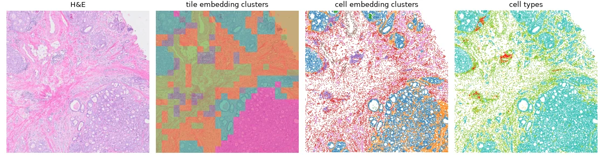
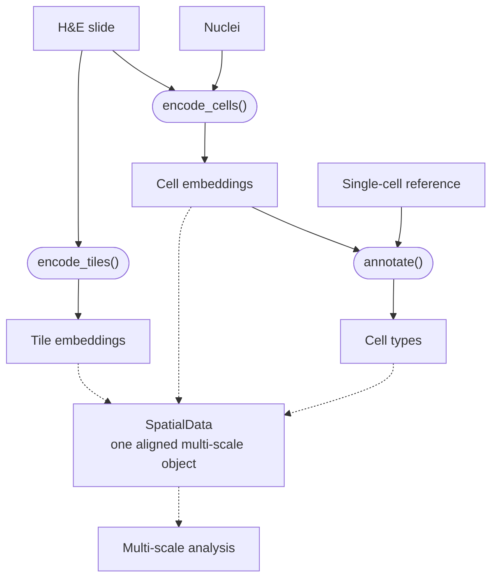

# ALHENA

**ALHENA, an H&E encoder distilled from transcriptomic foundation models for multi-scale slide analysis.**

ALHENA is a multi-scale encoder that learns molecularly informed representations directly from
H&E images. Built on the UNI2-h pathology backbone, it uses low-rank adaptation and contrastive
distillation from spatial transcriptomics models to capture tissue organization at both the tile
and cell levels.

At inference, no molecular measurements or dataset-specific fine-tuning are required. ALHENA
produces an embedding for each tissue tile and, when nuclei are provided, an embedding for each
cell. Cell types can then be assigned without retraining by comparing these image-derived cell
representations with a labeled single-cell reference. When the inputs share a spatial frame, all
outputs remain spatially aligned with the original slide, so tile-level, cell-level, and
cell-type information can be analyzed jointly for multi-scale characterization of the slide.

*One region of a slide, four layers: the H&E, tile embedding clusters, cell embedding clusters
and cell types. In the two cluster layers, colors mark unsupervised clusters, not predefined
classes. [Tutorial 4](tutorials/04_multiscale_analysis.ipynb) computes them. H&E:
[FFPE Human Breast with Custom Add-on Panel](https://www.10xgenomics.com/datasets/ffpe-human-breast-with-custom-add-on-panel-1-standard),
10x Genomics, [CC BY 4.0](https://creativecommons.org/licenses/by/4.0/).*

## Two scales of one slide

When spatial coordinates are available, tile embeddings, cell embeddings, and cell annotations
can be stored together in a SpatialData object, keeping all scales aligned with the original
slide for downstream multi-scale analysis. Each result also converts to an AnnData table, a core
data structure of the scverse ecosystem. ALHENA results are therefore compatible with scverse
analysis tools such as Scanpy and Squidpy, with or without SpatialData.
See [Downstream analysis](outputs/downstream-analysis.md).

- The **tile level** needs the image alone.
- The **cell level** also needs the nuclei, from a segmentation.
- **Cell types** also need a reference. ALHENA provides prebuilt references for fifteen human
  tissues.

## What do you want to do?

-   **Compute tile embeddings**

    H&E → `TileEmbeddings`

    [Choose your task](start/choose-your-task.md#compute-tile-embeddings) ·
    [Tutorial 1](tutorials/01_tile_embeddings.ipynb)

-   **Compute cell embeddings**

    H&E + nuclei → `CellEmbeddings`

    [Choose your task](start/choose-your-task.md#compute-cell-embeddings) ·
    [Tutorial 2](tutorials/02_cell_embeddings.ipynb)

-   **Annotate cells**

    `CellEmbeddings` + reference → `AnnotationResult`

    [Choose your task](start/choose-your-task.md#annotate-cells) ·
    [Tutorial 3](tutorials/03_cell_annotation.ipynb)

-   **Analyze the slide**

    Cluster tile and cell embeddings, study cell-type neighborhoods across the slide, and
    integrate tile- and cell-level information for multi-scale analysis.

    [Choose your task](start/choose-your-task.md#analyze-the-slide-across-scales) ·
    [Tutorial 4](tutorials/04_multiscale_analysis.ipynb)

You can also build a custom reference from a labeled single-cell atlas, to annotate cells with
your own taxonomy: [Choose your task](start/choose-your-task.md#build-a-custom-reference) ·
[Tutorial 5](tutorials/05_custom_reference.ipynb).

## What you need

| | Needed for |
|---|---|
| **An H&E image**, and its resolution in microns per pixel. | Everything except annotating cells you already encoded, or building a custom reference |
| **The UNI2-h model weights.** Their authors distribute them separately, under their own license. [Set up the UNI2-h model weights](start/getting-started.md#2-set-up-the-uni2-h-model-weights). | Everything except annotating cells you already encoded |
| **Nuclei**, from any nucleus segmentation. ALHENA does not segment: [If you have no nuclei yet](inputs/nuclei.md#if-you-have-no-nuclei-yet) shows how to segment a slide with sopa and StarDist. | Cell embeddings and cell types |
| **A reference.** ALHENA provides prebuilt references for fifteen human tissues, or you can build a custom reference. | Cell types |

!!! tip "Try it before you gather anything"
    `alhena demo Breast` reads a few annotated breast H&E fields from a public dataset, annotates
    their nuclei with the prebuilt breast reference and compares the predictions with the
    dataset's own nucleus categories. It needs the UNI2-h model weights.
    [Getting started](start/getting-started.md#4-run-the-demo) walks through it.

## About the name

ALHENA is gamma Geminorum, from the Arabic *al-han'ah*, a brand mark placed on something to make it readable. To the eye, it appears as a single star, though it is in fact a binary system. The light we see comes from a bright A-type subgiant. Its companion has never been imaged and reveals itself only through the faint wobble it leaves in the motion of the visible star. The H&E section is that visible star, inexpensive, familiar, and collected everywhere. The spatial transcriptome is the unseen companion, physically present, shaping what we observe, yet never directly accessible at inference.

---

**Next:** [Getting started](start/getting-started.md)
