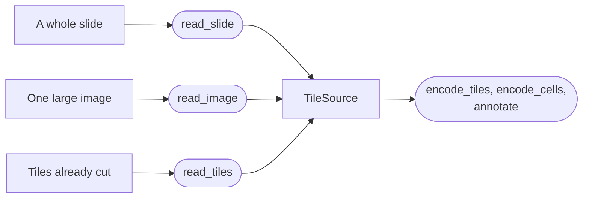

# Images

All H&E inputs are converted to a `TileSource`, which allows ALHENA to read image tiles on
demand. The same object is used whether the image comes from a whole slide, a large image, or
pre-extracted tiles.

For a whole-slide image:

```python
from alhena import io

source = io.read_slide("slide.svs")
print(source.mpp, source.mpp_source, source.tile_shape)
```

`read_slide()` reads the physical resolution from the slide metadata and chooses a tile size that
covers the physical field of view expected by the model.

## Supported image inputs

ALHENA supports three main image inputs. Each is converted to the same `TileSource` interface
before encoding.



A `TileSource` identifies each tile and reads it only when needed. When tile coordinates are
available, ALHENA also retains their spatial bounds so tile- and cell-level results can be mapped
back to the image.

### A whole slide

`read_slide()` reads image regions on demand, so the complete slide does not need to fit in
memory. Whole-slide reading requires the `wsi` extra:

```bash
pip install "alhena[wsi]"
```

It reads `.svs`, `.ndpi`, `.scn` and `.bif` files, as well as TIFF files, including OME-TIFF. Each
tile is named after its top-left pixel, such as `x381_y0`. See
[Supported slide formats](#supported-slide-formats) for the complete list.

### One large image

Use `read_image()` for a single image that is larger than one model tile, such as an exported
slide region, a crop, a `.png`, `.jpg`, single-level `.tif`, or a `(height, width, 3)` uint8
array. ALHENA divides the image into a grid before encoding.

```python
source = io.read_image("region.png", mpp=0.25)
print(len(source), source.tile_shape, source.image_shape)   # 9 (381, 381) (1000, 1000)
print(source.tile_ids[:3])                                  # ('x0_y0', 'x381_y0', 'x619_y0')
```

Do not pass a large image as a single tile. After resampling, ALHENA uses a 95.2 µm field of view
for each tile, so content outside that field is cropped. For example, if a 1000-pixel region at
0.25 µm/px is passed as one tile, only 14.5% of its area reaches the model. See
[A large field is cropped](../concepts/geometry.md#a-large-field-is-cropped).

`read_image()` reads no resolution from the file, so specify `mpp` or an explicit `tile_px`.
Arrays and `.npy` files can be read window by window; other image files are decoded when the
source is created.

### Tiles already cut

`read_tiles` reads tiles you cut yourself, in one of three forms.

=== "An array"

    ```python
    import numpy as np

    source = io.read_tiles(np.zeros((4, 256, 256, 3), dtype=np.uint8), mpp=0.25)
    print(source.tile_ids)      # ('0', '1', '2', '3')
    ```

    A stacked `(n_tiles, height, width, 3)` uint8 array, or a list of `(height, width, 3)`
    tiles, which may differ in size. Tiles are named by position unless `tile_ids=` names them.

    A `.npy` file holding a stacked array is read the same way, mapped from disk rather than
    loaded whole: `io.read_tiles("tiles.npy", mpp=0.25)`.

=== "A directory"

    ```python
    source = io.read_tiles("tiles/", mpp=0.5)
    print(source.tile_ids)      # ('x0_y0', 'x0_y224', 'x224_y0')
    ```

    One image file per tile: `.png`, `.jpg`, `.jpeg`, `.tif`, `.tiff`, `.bmp` or `.webp`. Each
    tile is named after its file, without the suffix. Files are taken in lexical order, so
    `x0_y224` comes before `x224_y0`. `pattern=` restricts which files are read, and hidden
    files never are.

=== "An HDF5 file"

    ```python
    source = io.read_tiles("tiles.h5", mpp=0.5)
    print(source.tile_ids)          # ('a', 'b', 'c')
    print(source.coords.tolist())   # [[0, 0], [224, 0], [0, 224]]
    ```

    By default, an HDF5 file stores tile images in `img`. It may also contain tile identifiers in
    `barcode` and tile origins in `coords`. If `barcode` is absent, tiles are identified by their
    position in the dataset; if `coords` is absent, no image position is recorded. Each optional
    dataset must contain one entry per tile. Tile identifiers and origins cannot be supplied
    through `tile_ids=` or `coords=` with an HDF5 file, even when the file does not store them;
    write them into the file instead.

    Datasets under other names are read by naming them:

    ```python
    source = io.read_tiles("patches.h5", mpp=0.5, image_dataset="imgs", coords_dataset="xy")
    ```

    `barcode_dataset=` names the third. A dataset you name must exist, so a typo is refused.
    On the command line, `--h5-datasets img=imgs coords=xy` does the same.

Tiles loaded from a directory or array do not have slide coordinates by default. Provide tile
origins to place them in a shared image coordinate system. Tile embeddings can then retain their
spatial bounds, and cell embeddings can retain cell positions. See
[Tiles without origins](coordinates.md#tiles-without-origins).

### Tile format requirements

Each tile must be a `(height, width, 3)` **uint8 RGB** array. Tiles do not need to be 224 × 224
pixels and do not need to share the same dimensions. Invalid arrays are refused with an
explanatory error:

```text
Tile 0 has dtype float32, where uint8 is expected. Tiles are bytes, one per channel.
```

!!! warning "Check the channel order of in-memory arrays"
    Image files and slides read from disk are converted to RGB automatically. Their transparent
    pixels are laid on white, the background of an H&E section. In-memory arrays, `.npy` files
    and HDF5 tiles are used as provided, so make sure they are RGB rather than BGR before passing
    them to ALHENA.

??? note "Stain normalization"
    ALHENA does not perform stain normalization. Tiles are resampled, cropped or padded as needed
    and then normalized with fixed channel statistics. If stain normalization is part of your
    workflow, apply it to the uint8 RGB image data before creating the `TileSource`.

## Resolution

`mpp` describes the physical resolution of the image data supplied to ALHENA, in microns per
pixel. It should reflect the pixels that are actually being read, not nominal scanner
magnification or the target resolution of the model. ALHENA handles the resampling internally.

=== "Whole-slide image"

    `read_slide` reads the resolution the file declares, and `mpp=` overrides it.

    ```python
    source = io.read_slide("slide.svs")
    print(source.mpp, source.mpp_source)
    ```

    A call over this source needs no `mpp`: it reads the tiles at the resolution the source
    carries. See [How a slide's resolution is read](#how-a-slides-resolution-is-read) for the
    metadata it reads and the cases it refuses.

=== "Pre-extracted tiles"

    Pass the resolution of the pyramid level you cut from. If you downsampled the tiles by two
    afterwards, pass twice the slide's pixel size.

    ```python
    source = io.read_tiles("tiles/", mpp=0.5)
    ```

=== "Resolution is unknown"

    Prefer a measured or documented pixel size over an estimate from scanner magnification.
    Values such as 0.25 µm/px for 40× and 0.5 µm/px for 20× are common, but they are not
    guaranteed.

!!! warning "Verify the image resolution before encoding"
    ALHENA can check whether an `mpp` value is plausible for microscopy, but it cannot verify that
    the value actually matches the image pixels. An incorrect but plausible resolution changes the
    physical field of view seen by the model without necessarily raising an error. Verify the
    image resolution before large-scale processing. See [Geometry](../concepts/geometry.md) for
    ways to inspect the resulting tile geometry.

## Tile size

In most workflows, leave `tile_px` unset. ALHENA will then choose a tile side that approximately
fills the model's 95.2 µm field of view at the resolution of the input image:

| Resolution | Tile side |
|---|---|
| 0.25 µm/px, typical of a 40x scan | 381 px |
| 0.5 µm/px, typical of a 20x scan | 191 px |
| within 2 percent of 0.425 µm/px | 224 px, not resampled at all |

Such tiles land on the model's canvas whole: no white pad, and almost no crop. That keeps the
tile geometry consistent across slides and cohorts.
[How large to cut](../concepts/geometry.md#how-large-to-cut) gives the rule for any resolution.

!!! warning "A 224-pixel input tile may not fill the model field of view"
    `tile_px` refers to pixels in the input image, not pixels on the model canvas. At 0.25 µm/px, a
    224-pixel tile covers only 56 µm. After resampling, it occupies 132 pixels of the 224-pixel
    model canvas and the remaining area is padded with white. This does not raise an error, so use
    the physical field of view rather than the number 224 alone when choosing a tile size. See
    [A small field pads with white](../concepts/geometry.md#a-small-field-pads-with-white).

## Choosing which tiles

`read_slide()` does not perform tissue detection. If the full slide is tiled directly, background
regions are included and encoded like any other tile.

If tissue regions have already been selected by another tool, pass the retained tile origins
through `coords=`:

```python
source = io.read_slide("slide.svs", coords="patches.h5")
print(source.tile_ids)      # ('x512_y512', 'x893_y512', 'x512_y893')
```

`coords` is an `(n_tiles, 2)` array of x then y, or a file holding one:

- an HDF5 file with a `coords` dataset; `coords_dataset=` names another;
- a `.csv`, `.tsv`, `.txt` or `.parquet` table of `x` and `y` columns; `columns=` names others;
- a `.npy` array.

Each origin must be a whole number of full-resolution pixels, inside the image, given once. The
tiles are cut at `tile_px`, or at the filling side when `tile_px` is unset, in the order the
origins are given. `read_image` takes `coords=` the same way, in its own pixels, and so does
`--coords` on the command line.

To keep one rectangle of the slide, pass `region=` as x0, y0, x1, y1 in full-resolution pixels,
upper bounds excluded. Only the tiles lying wholly inside it are kept, from the grid or from
`coords`:

```python
source = io.read_slide("slide.svs", region=(10000, 8000, 20000, 18000))
```

`read_image` takes `region=` in its own pixels, and so does `--region` on the command line.

If an external patch index records a different tile size, ALHENA warns and still cuts the tiles
at the side described above. If stored tiles were resized after extraction, the relationship
between tile pixels and image pixels must be specified explicitly. See
[Tiles stored at another size](coordinates.md#tiles-stored-at-another-size).

## An image in a SpatialData object

Use `spatial.tile_source()` to expose an image stored in SpatialData through the same
`TileSource` interface used by the other image readers:

```python
import alhena
from alhena import spatial

source = spatial.tile_source(sdata, image_key="he", mpp=0.25)
encoder = alhena.load_encoder()
tiles = encoder.encode_tiles(source)
```

By default, tiles are generated over level 0 of the selected image. Existing patch windows stored
in the SpatialData object can instead be supplied through `patches=`. In both cases, tile
coordinates remain expressed in the pixel frame of that image. This functionality requires the
`spatial` extra. See [SpatialData API](../api/spatial.md).

## Advanced

The rest of this page is reference material for less common cases.

### How a slide's resolution is read

Without `mpp=`, `read_slide` reads the resolution of the full-resolution level from the first
metadata source that declares one, in this order:

1. **OME metadata**: `PhysicalSizeX` of the full-resolution image, in the unit it names.
2. **Scanner metadata**: `aperio.MPP`, then `tiffslide.mpp-x`, then `openslide.mpp-x`.
3. **TIFF resolution tags**: `XResolution` and `YResolution`, in the unit `ResolutionUnit` names.

`source.mpp_source` records which metadata source was used, such as `"OME PhysicalSizeX"`,
`"aperio.MPP"` or `"TIFF resolution tags"`. The order above favors the most deliberate
declarations. TIFF resolution tags come last because many programs fill them with screen or
printer defaults that are unrelated to the microscopy image.

A slide is refused rather than assigned a guessed resolution when:

- it declares no resolution;
- the first source that declares one cannot be interpreted, such as a `PhysicalSizeX` in `pixel`;
- the declared resolution lies outside 0.02 to 20 µm/px, the range accepted for a microscope image.

A screen default of 72 dots per inch reads as 352.8 µm/px, so it is refused:

```text
export.tif declares 352.8 micron per pixel in its TIFF resolution tags, XResolution 72 pixels
per inch, outside the 0.02 to 20 micron per pixel of a microscope image: reaching the 0.425
micron per pixel the encoder reads would enlarge each tile 830 times. Resolution tags often hold
a default of the program that wrote the file, a screen's or a printer's dots per inch, rather
than a calibration. Pass mpp= to declare the resolution of its full-resolution level.
```

`mpp=` explicitly declares the resolution of the full-resolution level and takes precedence over
the resolution stored in the slide. Use it when the file has no usable resolution metadata or
when the stored value is known to be wrong. If the stored value and `mpp=` differ by more than
2 percent, ALHENA uses `mpp=` and a `GeometryWarning` reports both values.

```python
source = io.read_slide("export.tif", mpp=0.25)   # resolution documented for this H&E scan
```

Use the pixel size documented for the H&E scan itself, from the scanner record or the image
provider. Three cases need care.

- **Each slide can have its own resolution.** Slides scanned at the same nominal magnification can
  still have slightly different pixel sizes. `read_slide` reads each slide's own resolution and
  cuts its tiles accordingly, so one call can serve a whole cohort.
- **Stored resolution metadata can be wrong.** If the value embedded in the file differs from the
  documented calibration, pass the documented value with `mpp=`.
- **Do not use the pixel size of another registered image.** An H&E image registered to another
  image of the same section was still scanned independently. Use the pixel size of the H&E image,
  not that of the registered image.

### The tile source

Every reader returns a `TileSource`: a sequence of tiles **read on demand**. A set larger than
memory is embedded one batch at a time, never loaded whole.

| Attribute | Holds |
|---|---|
| `tile_ids` | the name of each tile |
| `mpp` | the resolution of the tiles, where known |
| `tile_shape` | the shared tile size, or `None` for tiles of several sizes and for a directory of files |
| `coords` | the top-left pixel of each tile in the image, or `None` |
| `coords_frame` | the name of the frame `coords` is written in |
| `coords_scale` | image pixels per tile pixel |
| `image_shape` | height and width of the image the tiles were cut from, for `read_slide` and `read_image` |

```python
for batch in source.batches(batch_size=32):
    ...                        # a list of tiles, read now
source.close()                 # or use the source as a context manager
```

Indexing returns one tile. Slicing is refused because it could load many tiles at once, defeating
the purpose of on-demand reading. Use `batches()` to read several tiles at a time. Tiles already in
memory are wrapped into a source by `io.as_tile_source`, which `encode_tiles` calls for you.
`io.tile_bounds(source)` returns the window of every tile, `(n_tiles, 4)` as `x0, y0, x1, y1`.

### The edges of a grid

A grid rarely fits an image a whole number of times. `edge=` says what happens to the tiles
that the right and bottom edges cut, under one of three rules, `EDGE_RULES`:

| `edge` | The tiles the edge cuts | Every pixel read | Default of |
|---|---|---|---|
| `"drop"` | left out | no: a band up to one tile wide is never read | |
| `"shift"` | moved inward to end at the edge, overlapping their neighbors | yes | `read_image`, `spatial.tile_source` |
| `"pad"` | read whole, white past the edge | yes | `read_slide` |

On a 1000 pixel image cut at 381 pixels, `"drop"` cuts 4 tiles, and `"shift"` and `"pad"` cut 9.

The defaults differ because the boundaries mean different things. A region may contain tissue up to
its edges, so `shift` moves edge tiles inward to keep them entirely on-image. A slide is glass at
its outer edges, so `pad` extends that background with white and preserves one tile per grid window
without overlap. No rule introduces black: although the slide reader returns black beyond the edge
of a level, `read_slide` replaces it with the same white used for canvas padding. Tiles selected
with `coords=` follow the same rule. Under `"drop"`, any selected tiles that are omitted are counted
in a warning.

Nuclei are read only where the image is. A padded tile is white past the edge, so no nucleus
pixel there is pooled. A nucleus lying wholly past the edge reaches no token and has no row in
the result, as under the other rules. A nucleus the edge cuts is read from its part on the image.

### Pyramid levels

`level=` reads a coarser level of a slide:

```python
source = io.read_slide("slide.svs", tile_px=224, level=1)   # a level of downsample 4
print(source.tile_ids[:2], source.coords_scale)            # ('x0_y0', 'x896_y0') 4.0
```

Whatever the level, origins are recorded in the pixels of level zero, and tiles are named after
them. `coords_scale` is then the downsample of the level: one tile pixel spans that many pixels
of level zero. Nuclei written in level-zero pixels therefore meet the tiles of any level.
`source.mpp` reports the resolution of the level read; `mpp=` declares that of level zero.

??? note "A downsample that is not a whole number"
    A level whose sides were rounded when the pyramid was written has a downsample such as
    4.0003. Each origin is then the first level-zero pixel that maps to the corner of its tile,
    so it lies less than one level-zero pixel past that corner.

### Supported slide formats

Slides are read by tiffslide, which reads TIFF-based formats.

| Format | Suffix | Read |
|---|---|---|
| Aperio SVS | `.svs` | fully |
| Leica SCN | `.scn` | fully |
| Generic TIFF, OME-TIFF and BigTIFF | `.tif`, `.tiff`, `.btf` | fully |
| Hamamatsu NDPI | `.ndpi` | with part of its metadata; the resolution comes from its TIFF tags |
| Ventana | `.bif` | partly: none of its own metadata is read |
| MIRAX, Hamamatsu VMS and VMU, DICOM, Zeiss ZVI and CZI | `.mrxs`, `.vms`, `.vmu`, `.dcm`, `.zvi`, `.czi` | not at all |

Any TIFF is read as a slide, with or without a pyramid. A file in a format that is not read is
refused, naming the format, before it is opened. So is a file without a TIFF header, whatever its
suffix. So is a TIFF whose images the slide reader cannot arrange into levels, such as a stack of
planes, of channels or of time points, and a TIFF that stores its color one plane per channel
where the reader cannot lay it out. Export such a slide to a pyramidal TIFF of one RGB image,
with the channels interleaved. Declare `mpp=` if the export carries no resolution.

??? warning "tiffslide installed but reported missing"
    The `wsi` extra requires `tiffslide>=2.5.1`. An older tiffslide installs, then fails to
    import, and that failure reads exactly as a missing install:

    ```text
    Reading whole slides needs tiffslide. Install it with pip install "alhena[wsi]".
    ```

    `python -c "import tiffslide"` tells the two cases apart.

---

**Next:** [Nuclei](nuclei.md)
