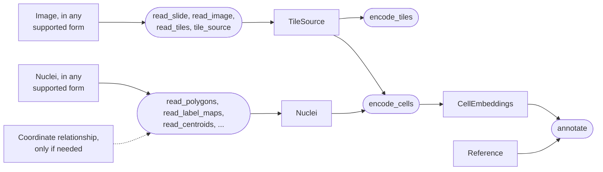

# Inputs

ALHENA uses four main inputs: an H&E image source, nuclei, previously computed cell embeddings,
and a single-cell reference. The inputs required depend on the task, and each can be loaded from
several supported formats.

| Logical input | What it is | Needed for |
|---|---|---|
| **Image source** | the H&E image, as a `TileSource` | tile embeddings, cell embeddings |
| **Nuclei** | where each nucleus is, as a shape or a position | cell embeddings |
| **Cell embeddings** | cells encoded earlier, as `CellEmbeddings` | cell annotation |
| **Reference** | a labeled single-cell reference | cell annotation |

## A typical image-and-nuclei workflow

```python
from alhena import io

source = io.read_slide("slide.svs")
nuclei = io.read_polygons("nuclei.geojson", tiles=source)
```

Once the image and nuclei have been loaded, pass only the inputs required by the task:

| Task | Logical inputs |
|---|---|
| Tile embeddings, with `encode_tiles` | image source |
| Cell embeddings, with `encode_cells` | image source and nuclei |
| Annotate saved cells, with `annotate` | `CellEmbeddings` and reference |
| Encode and annotate directly, with `annotate` | image source, nuclei and reference |

[Choose your task](../start/choose-your-task.md) gives the call for each.

## Different formats, same workflow

The same input can be provided in different forms. For example, H&E data may come from a
whole-slide image or pre-extracted tiles, and nuclei may be represented by polygons, label maps,
or centroids. Only the loading step changes; the ALHENA workflow remains the same.



`annotate()` can also take an image source and nuclei directly. In that case, it computes the cell
embeddings before performing the annotation.

- [Images](images.md): load whole-slide images, large images, or pre-extracted tiles.
- [Nuclei](nuclei.md): load nucleus polygons, label maps, masks, centroids, or other supported
  representations.
- [Coordinates](coordinates.md): describe the spatial relationship between images, tiles, and
  nuclei when they are not already expressed in the same pixel coordinate system.
- [References](references.md): select or build a single-cell reference for cell-type annotation.

## A checklist for your data

Before running an analysis, check the items relevant to your workflow.

### Image questions

For every task that encodes H&E:

1. **What is the physical resolution of the H&E image?** For whole-slide images, `read_slide()`
   reads the resolution from the slide metadata and records its source in `mpp_source`. For
   exported images or pre-extracted tiles, use the documented pixel size of the image data rather
   than nominal scanner magnification. If the tiles were resampled after extraction, use their
   post-resampling resolution. See [Resolution](images.md#resolution).
2. **How are the image data stored?** Whole slides, large images, directories of tiles, arrays,
   and HDF5 files are loaded differently. Some formats may also require dataset names or
   information about how stored tiles relate to the original image. See [Images](images.md).
3. **Does the tile geometry match the intended physical field of view?** Use `describe_geometry()`
   before a large run when the image resolution or tile size is unusual. See
   [Check before you run](../concepts/geometry.md#check-before-you-run).

### Additional cell questions

For cell embeddings:

1. **How are the nuclei represented?** ALHENA accepts polygons, label maps, a whole-image label
   image, binary masks, centroids, and membership tables. See
   [Supported nucleus representations](nuclei.md#supported-nucleus-representations). If there
   are none yet, see [If you have no nuclei yet](nuclei.md#if-you-have-no-nuclei-yet).
2. **Which coordinate system contains the nuclei?** They may be expressed in tile pixels,
   whole-image pixels, microns, or the pixels of another registered image. See
   [Coordinates](coordinates.md).
3. **Are cell identifiers unique?** Cell identifiers must refer to the same cell everywhere they
   are used, including any external labels joined later. See [Identifiers](nuclei.md#identifiers).

### Additional annotation questions

For cell types only:

1. **Which tissue should the reference represent?** `alhena reference list` shows the available
   tissues and accepted aliases. See [References](references.md).
2. **Which species is being analyzed?** The prebuilt ALHENA references are derived from human
   single-cell atlases. See [Human tissue](references.md#human-tissue).
3. **Which annotation axis should be used?** `lineage_v1` is the default five-class lineage axis,
   while `compartment_v1` holds three broad cell classes. See
   [The class axis](references.md#the-class-axis).

---

**Next:** [Images](images.md)
