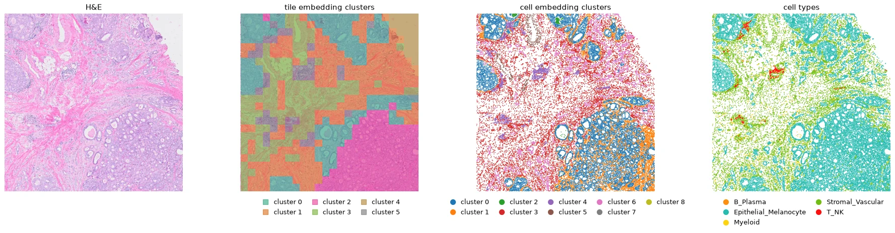
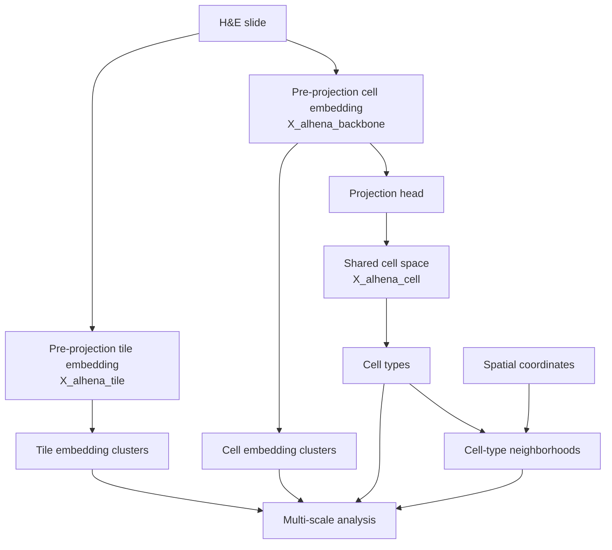

# Downstream analysis

ALHENA provides complementary representations of an H&E image at tile and cell scales.
Pre-projection tile and cell embeddings can be explored independently, while projected cell
embeddings support reference-based cell-type annotation. When spatial coordinates are available,
these results can also be related directly on the slide.

This page shows common downstream analyses with Scanpy, Squidpy, and SpatialData. These tools are
not required by ALHENA; they are examples of how the returned representations can be analyzed.



*One 2.3 mm region shown as H&E, tile embedding clusters, cell embedding clusters, and predicted
cell types. Cluster colors represent unsupervised groups in the embedding spaces and are not
predefined biological classes.
[Tutorial 4](../tutorials/04_multiscale_analysis.ipynb) computes each layer.
H&E: [FFPE Human Breast with Custom Add-on Panel](https://www.10xgenomics.com/datasets/ffpe-human-breast-with-custom-add-on-panel-1-standard),
10x Genomics, [CC BY 4.0](https://creativecommons.org/licenses/by/4.0/); cropped, downsampled
and overlaid with ALHENA results.*



The examples below start from two results: `tiles`, returned by `encode_tiles()`, and `result`,
returned by `annotate()` on the default axis, `lineage_v1`. Each converts to an AnnData table with
`to_anndata()`, and the analyses run on those tables. The columns of an annotation are named
after its axis, so the cell types of `result` are in `alhena_celltype_lineage_v1`.
[Tutorial 4](../tutorials/04_multiscale_analysis.ipynb) runs every step below on one slide region,
with its figures.

## Which representation for which question

| Question | Representation | Typical analysis |
|---|---|---|
| Which tissue regions have similar ALHENA representations? | `X_alhena_tile` | neighbors, UMAP, clustering into tile embedding clusters |
| Which cells have similar image-derived representations? | `X_alhena_backbone` | neighbors, UMAP, clustering into cell embedding clusters |
| How are cells arranged in the shared space used for annotation? | `X_alhena_cell` | visualization of annotation/retrieval geometry |
| Which cell type was assigned to each cell? | `alhena_celltype_lineage_v1` | composition summaries |
| Which cell types occur near one another in physical space? | `spatial` + `alhena_celltype_lineage_v1` | spatial-neighbor analyses |
| How do tile- and cell-level results relate? | clusters, cell types, and shared spatial coordinates | cross-scale analyses |

## Embedding space and physical space

These coordinate systems answer different questions. **Embedding space** measures similarity
between ALHENA representations and is used for nearest-neighbor graphs, dimensionality reduction,
and clustering. **Physical space** represents positions on the slide and is used for
spatial-neighbor and neighborhood analyses.

Similarity in embedding space does not imply physical proximity on the slide, and spatially
adjacent observations do not necessarily have similar embeddings.

## Tile embedding clusters

Clustering `X_alhena_tile` groups tiles with similar ALHENA representations. These groups are
**tile embedding clusters**; they are not predefined tissue classes.

```python
import scanpy as sc

tile_table = tiles.to_anndata()
sc.pp.neighbors(tile_table, use_rep="X_alhena_tile")
sc.tl.umap(tile_table)
sc.tl.leiden(
    tile_table,
    key_added="tile_cluster",
    resolution=0.5,
    flavor="igraph",
    n_iterations=2,
)
```

Interpret each cluster by examining the corresponding H&E regions and their spatial distribution
before attaching a biological description. The Leiden `resolution` parameter controls clustering
granularity.

```python
ax = sc.pl.embedding(tile_table, basis="spatial", color="tile_cluster", show=False)
ax.invert_yaxis()
```

Spatial coordinates allow the clusters identified in embedding space to be mapped back onto the
slide. This step requires tiles with spatial bounds. `viz.tile_regions()` draws each tile region
in the color of its cluster, over the part of the slide `io.read_region()` reads. Given the table
and the name of a column, it uses the colors Scanpy stored for that column:

```python
from alhena import io, viz

he, extent = io.read_region("slide.svs", window=tiles.bounds, downsample=8)
viz.tile_regions(tile_table, "tile_cluster", image=he, extent=extent)
```

## Cell embedding clusters

The same workflow can be applied to `X_alhena_backbone`, ALHENA's pre-projection cell
representation. Keep the cells whose embedding is valid:

```python
cell_table = result.to_anndata()
cell_table = cell_table[cell_table.obs["alhena_embedding_valid"]].copy()

sc.pp.neighbors(cell_table, use_rep="X_alhena_backbone")
sc.tl.umap(cell_table)
sc.tl.leiden(
    cell_table,
    key_added="cell_cluster",
    resolution=0.3,
    flavor="igraph",
    n_iterations=2,
)
```

The resulting **cell embedding clusters** describe unsupervised structure in the image-derived
representation and should not be interpreted automatically as biological cell states or cell types.

These clusters do not depend on the single-cell reference used for annotation.

!!! tip "Inspect cell clusters in spatial context"
    Each cell embedding includes information pooled from a nucleus whose image tokens were computed
    within a surrounding tile. Cells from the same tile therefore share some contextual
    information. Map cell embedding clusters back to the slide before interpreting them,
    particularly if cluster boundaries appear strongly aligned with tile boundaries.

## The shared cell space

`X_alhena_cell` holds the same cells in the shared cell space, where annotation happens:

```text
pre-projection cell embedding
X_alhena_backbone
        ↓ img_tok_proj
shared cell-space embedding
X_alhena_cell
        ↓ reference retrieval
cell-type annotation
```

`X_alhena_cell` can be visualized, but it represents a different analysis space from
`X_alhena_backbone`. It is specifically optimized for comparison with the single-cell reference.

```python
sc.pp.neighbors(cell_table, use_rep="X_alhena_cell", key_added="cell_space")
sc.tl.umap(cell_table, neighbors_key="cell_space", key_added="X_umap_cell_space")
sc.pl.embedding(cell_table, basis="X_umap_cell_space", color="alhena_celltype_lineage_v1")
```

The table stores the colors of the cell types beside them, so Scanpy draws the cell types in the
colors of `alhena.viz`.

Separation of annotated cell types in this space is therefore partly expected because the
annotations themselves are obtained by retrieval in the same space. Use the pre-projection
representation for general unsupervised analysis of cellular variation.
[The shared cell space](../concepts/how-it-works.md#the-shared-cell-space) says how it relates to
scConcept.

## Cell embedding clusters and cell types

Cell embedding clusters and reference-derived cell types provide complementary descriptions of the
cells:

- **cell embedding clusters** are obtained by unsupervised clustering of `X_alhena_backbone`;
- **cell types** are assigned by reference retrieval after projection into `X_alhena_cell`.

```python
import pandas as pd

sc.pl.umap(cell_table, color=["cell_cluster", "alhena_celltype_lineage_v1"])
pd.crosstab(cell_table.obs["cell_cluster"], cell_table.obs["alhena_celltype_lineage_v1"])
```

Comparing them can reveal whether a reference-defined type forms one or several image-derived
clusters, or whether a cluster contains several predicted cell types. These relationships should
be interpreted from the underlying H&E and relevant biological context rather than treated as
expected agreement.

## Cell types in physical space

Cell-type annotations can also be analyzed using the physical positions of the cells. The example
below retains cells with valid annotations and constructs a spatial-neighbor graph with a maximum
distance of 30 µm:

```python
import squidpy as sq

cell_type = "alhena_celltype_lineage_v1"
called = cell_table[cell_table.obs["alhena_valid_lineage_v1"]].copy()
mpp = called.uns["alhena_cells"]["centroids_mpp"]    # microns per pixel of the positions

sq.gr.spatial_neighbors_delaunay(called, radius=(0, 30 / mpp))
sq.gr.nhood_enrichment(called, cluster_key=cell_type)
sq.pl.nhood_enrichment(called, cluster_key=cell_type)
```

The resulting spatial graph and the cell positions can support analyses such as:

- where each cell type lies on the slide;
- neighborhood enrichment: which types neighbor each other more, or less, than chance;
- co-occurrence of types as a function of distance, with `sq.gr.co_occurrence`;
- cellular niches, from the composition of each cell's neighbors.

Positions are in the pixels of `centroids_frame`. `centroids_mpp` converts between those pixels
and microns, as for the 30 µm distance above. The graph functions shown need Squidpy 1.8.2 or newer.

## Across scales

Tile- and cell-level results can be related when they share the same spatial context.

`tiles.locate()` names the tile whose region holds each cell, from the positions of the cells and
the spatial bounds of the tiles. The tile table is indexed by the same names, so a tile-level value
reaches the cells by name:

```python
cluster_of_tile = tile_table.obs["tile_cluster"]

for table in (cell_table, called):
    table.obs["tile_cluster"] = cluster_of_tile.reindex(tiles.locate(table)).to_numpy()
```

`locate()` works whether the tiles and the cells were read in one pass or in two, over the same
region or not. The tile bounds and the cell positions must be in the same coordinate frame, and
`locate()` refuses frames that differ. A cell outside every tile gets no tile and no value.

Each cell also records, in `alhena_tile_index`, the tile its embedding was read from, by its
position among the tiles of that pass.

### Tile clusters and cell types

```python
by_type = pd.crosstab(
    called.obs["tile_cluster"],
    called.obs["alhena_celltype_lineage_v1"],
    normalize="index",
)
```

This table summarizes the distribution of reference-derived cell types within each tile embedding
cluster.

### Tile clusters and cell clusters

```python
by_cluster = pd.crosstab(
    cell_table.obs["tile_cluster"],
    cell_table.obs["cell_cluster"],
    normalize="index",
)
```

This comparison relates unsupervised regional structure in `X_alhena_tile` to unsupervised
cellular structure in `X_alhena_backbone`.

The two representations are not fully independent because the cell embedding is pooled from image
tokens computed in the context of a tile.

### Tile clusters and cell-type neighborhoods

Physical cell neighborhoods can also be summarized within tile embedding clusters to compare local
cellular organization across image-derived tissue regions.
[Tutorial 4](../tutorials/04_multiscale_analysis.ipynb) shows an example.

The aligned tile and cell outputs make these questions directly accessible:

- Which predicted cell types are enriched in each tile embedding cluster?
- Which cell embedding clusters occur within each tile embedding cluster?
- How does cellular composition vary across image-derived tissue regions?
- Do different tile embedding clusters contain different cell-type neighborhoods?

The appropriate downstream statistical model depends on the biological question and study design.

## Keep the scales together

A SpatialData object keeps every layer of the analysis in one registered spatial context:

```text
SpatialData
├── images
│   └── the H&E
├── shapes
│   ├── the tile regions
│   └── the nucleus outlines
└── tables
    ├── the tile table    tile embeddings, tile embedding clusters
    └── the cell table    pre-projection and cell-space embeddings, cell types, cell embedding clusters
```

That matters for multi-scale work:

- the H&E image, nuclei, and ALHENA results remain registered in shared coordinate systems;
- tile clusters remain associated with their spatial regions;
- cell annotations and cell clusters remain associated with cell positions or nucleus shapes;
- coordinate transformations are preserved rather than recreated manually;
- spatial queries can retrieve several analysis layers from the same region.

Two calls write ALHENA's results into an object that already holds the image and the nuclei:

```python
from alhena import spatial

spatial.tiles_to_spatialdata(sdata, tiles, image_key="he")
spatial.cells_to_spatialdata(sdata, result, region="nucleus_boundaries")
```

Part F of [Tutorial 4](../tutorials/04_multiscale_analysis.ipynb) builds such an object from a
slide, adds the embedding clusters, and queries it. See
[Writing into a SpatialData object](persistence.md#writing-into-a-spatialdata-object).

## Scanpy, Squidpy and SpatialData

| Tool | Role | Works on |
|---|---|---|
| Scanpy | similarity structure, dimensionality reduction, and clustering in ALHENA embedding spaces | `X_alhena_tile`, `X_alhena_backbone`, `X_alhena_cell` |
| Squidpy | spatial-neighbor and neighborhood analyses | cell positions with annotations or cluster labels |
| SpatialData | registration and joint storage of images, nuclei, ALHENA tables, and coordinate transformations | spatial layers from the same analysis |

These packages are optional downstream tools rather than components of the ALHENA model. ALHENA
embeddings are image-derived representation features and should not be interpreted as
gene-expression matrices.

## Advanced: comparing slides and cohorts

ALHENA produces tile- and cell-level representations rather than a predefined slide-level
embedding. Slide- or patient-level summaries must therefore be constructed downstream according to
the analysis question. Examples include aggregating tile embeddings, summarizing predicted
cell-type composition, or training a downstream model using study-specific labels.

Before comparing such summaries across slides or cohorts, consider at least three sources of
variation:

1. **Image geometry.** Differences in resolution, padding, or cropping can affect tile embeddings
   independently of tissue morphology. Use comparable preprocessing geometry across datasets. See
   [How large to cut](../concepts/geometry.md#how-large-to-cut).
2. **Tissue selection.** `read_slide()` does not perform tissue detection. If whole-slide grids are
   used, background regions can influence tile-level summaries. Define tissue regions consistently
   before aggregation. See [Choosing which tiles](../inputs/images.md#choosing-which-tiles).
3. **Reference and annotation axis.** Cell-type composition should be compared using compatible
   references and the same annotation axis. Differences in reference composition can influence
   retrieval-based annotations. See
   [How reference composition affects annotation](../concepts/references.md#how-reference-composition-affects-annotation).

---

**Next:** [Persistence and interchange](persistence.md)
