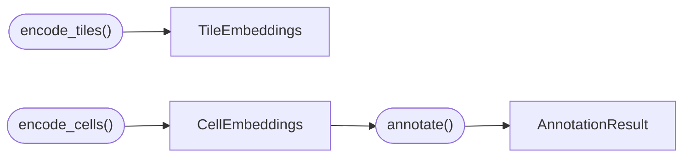

# Outputs

ALHENA returns three main result objects covering tile-level representations, cell-level
representations, and cell-type annotations.



| Result | One row represents | Produced by | Main content | Page |
|---|---|---|---|---|
| `TileEmbeddings` | one tissue tile | `encode_tiles()` | a 1536-dimensional tile embedding, spatial bounds when available, and encoding geometry | [Tile embeddings](tile-embeddings.md) |
| `CellEmbeddings` | one cell | `encode_cells()` | a 1536-dimensional pre-projection cell embedding, a 512-dimensional projected cell-space embedding, cell position when available, and provenance | [Cell embeddings](cell-embeddings.md) |
| `AnnotationResult` | one cell | `annotate()` | a reference-based cell-type annotation, confidence, validity flag, and the `CellEmbeddings` used for annotation | [Cell annotations](cell-annotations.md) |

## Three results, two scales

- **`TileEmbeddings`** describes the slide at the tile level. Each row represents one tissue
  region.
- **`CellEmbeddings`** describes the slide at the cell level. Each row represents one nucleus
  together with its local tissue context.
- **`AnnotationResult`** adds reference-based cell-type annotations to the cell-level
  representation.

Tile- and cell-level outputs are complementary. When spatial coordinates are available, both
remain aligned with the original image and can be combined for multi-scale analysis. See
[Downstream analysis](downstream-analysis.md).

## What each representation is for

ALHENA exposes representations before and after the projection used for contrastive alignment:

```text
TILE LEVEL
└── TileEmbeddings
    └── X_alhena_tile            pre-projection tile embedding

CELL LEVEL
├── CellEmbeddings
│   ├── X_alhena_backbone        pre-projection cell embedding
│   └── X_alhena_cell            projected embedding in the shared cell space
└── AnnotationResult
    └── alhena_celltype_<name>   reference-based cell-type annotation
```

- **`X_alhena_tile` and `X_alhena_backbone`** are the pre-projection representations used for
  general downstream analysis such as neighbors, dimensionality reduction, and clustering.
- **`X_alhena_cell`** is the projected cell representation used to compare image-derived cells
  with single-cell references.
- **`alhena_celltype_<name>`** is the class assigned through reference retrieval. `<name>` is the
  name of the annotation: its axis, such as `lineage_v1`, unless another name was given. One cell
  table can therefore hold annotations on several axes side by side.

See [How ALHENA works](../concepts/how-it-works.md) for the relationship between these
representations.

## From a result to analysis and storage

Each result can be used directly as a Python object, converted to AnnData for downstream
analysis, and optionally integrated into SpatialData when spatial context should be preserved.

1. **Python object:** `TileEmbeddings`, `CellEmbeddings`, or `AnnotationResult`.
2. **AnnData:** an analysis-ready table returned by `to_anndata()`.
3. **SpatialData:** an optional container that keeps the H&E image, nuclei, and ALHENA results in
   shared coordinate systems.
4. **Files:** `.h5ad` and lighter export formats for persistence and interchange.

See [Persistence and interchange](persistence.md) for the supported formats.

## Outputs reused across steps

Two workflows retain intermediate results that can be reused:

- `encode_cells()` stores the tile embeddings generated during cell encoding in `cells.tiles`.
  These are the tiles required by the cell workflow and should not automatically be interpreted
  as a systematic tile-level sampling of the slide. See
  [Dedicated tiles and cell-context tiles](tile-embeddings.md#dedicated-tiles-and-cell-context-tiles).
- When `annotate()` is called directly with an image and nuclei, it first computes
  `CellEmbeddings` and stores them in `result.cells`.

## Lower-level encoder outputs

For workflows that do not need the result objects:

- `encoder.encode(tiles, mpp=...)` returns only the tile embedding matrix with shape
  `(n_tiles, 1536)`.
- `encoder.encode_with_tokens(tiles, mpp=...)` additionally returns patch-token representations
  with shape `(n_tiles, 256, 1536)`.

These lower-level functions do not attach tile identifiers, spatial coordinates, or result
provenance.

---

**Next:** [Tile embeddings](tile-embeddings.md)
